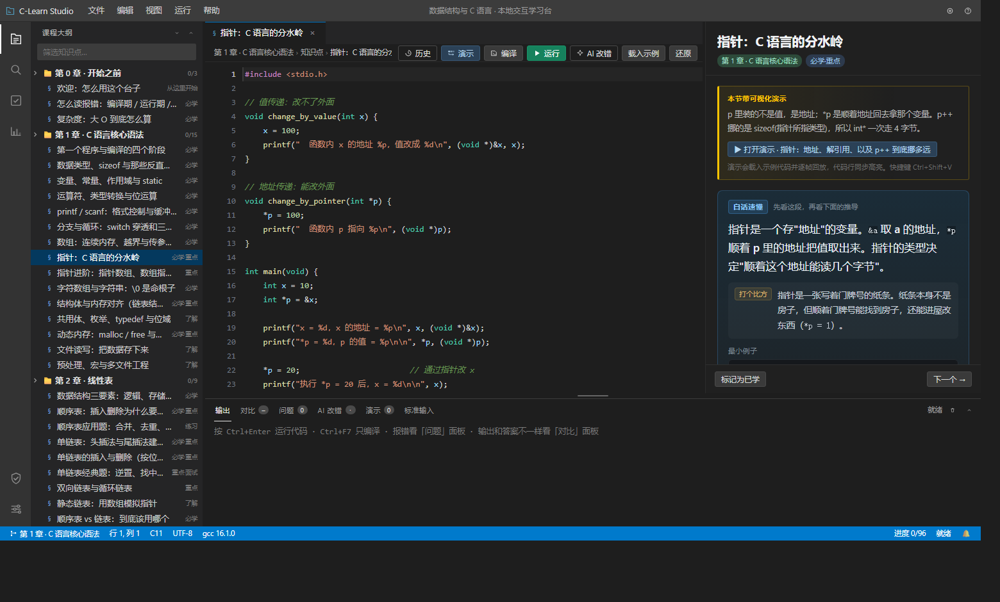
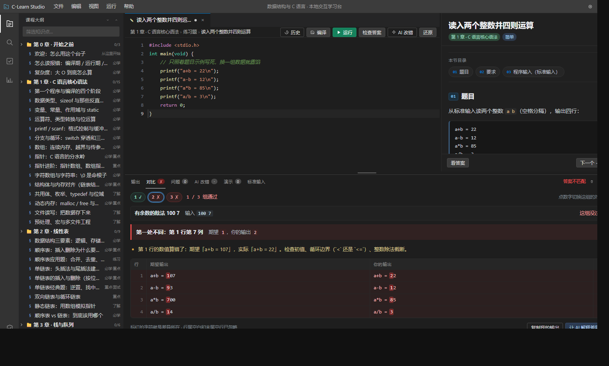
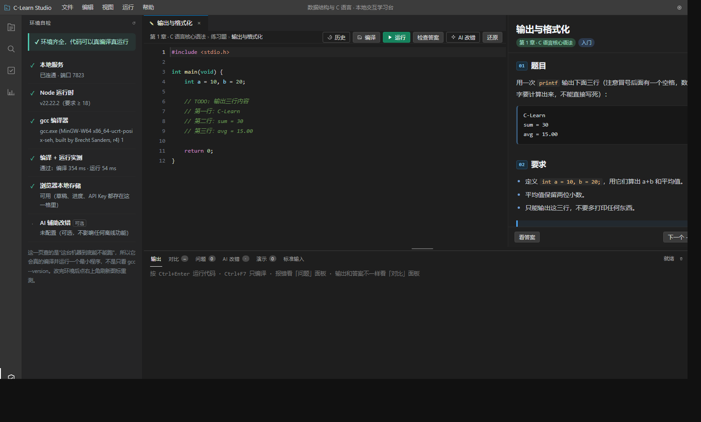

# C-Learn Studio

一个跑在本机的 C 语言 + 数据结构学习台。界面仿 VS Code Dark+，代码**真编译真执行**（调用本机 gcc），
不联网也能用；联网只是可选项——挂一个自己的 API Key，AI 才会在旁边帮你讲错。

> 本地学习台 · v1.2.1
> 62 个知识点 / 34 道练习题（其中 5 道跑多组用例）/ 19 个可视化演示（334 帧）
> 62 张白话定义卡 / 30 条报错翻译规则 / 34 条结构约束 / 55 项界面自检





## 下载即用（Windows 10 / 11）

只需要一次性装两个东西：**Node.js 18+** 和 **gcc**。逐步骤、带截图和常见报错的版本在 **[INSTALL.md](INSTALL.md)**。

```powershell
winget install --id OpenJS.NodeJS.LTS -e
winget install --id BrechtSanders.WinLibs.POSIX.UCRT -e
```

> 装完**关掉所有窗口重开**（PATH 是启动时读的）。没有 winget 就看 [INSTALL.md](INSTALL.md) 里的手动安装。

1. 从 [**Releases**](https://github.com/CLOUD02142/c-learn-studio/releases/latest) 下载 `c-learn-studio-v1.2.1.zip`
   （也可以右上角 Code → Download ZIP，或 `git clone`）；
2. 解压到普通目录（例如 `D:\C-Learn-Studio`，别放 `C:\Program Files`）；
3. 双击 **`启动.bat`**，浏览器自动打开 `http://127.0.0.1:7788`；
4. 点左侧盾牌图标 → **环境自检**，四项全绿就能写代码了。有 ✗ 的项，页面上直接给了修复命令。

没装 gcc 也能先打开看教程、写代码、看演示，只是跑不起来——程序会明确告诉你缺什么。

## 怎么启动

双击 `启动.bat`（或在目录里执行 `node server.js`）。浏览器会自动打开，端口默认 7788，
被占用时自动往后顺延，服务那边会打开正确的地址。关掉黑窗口就是退出。

AI 改错是**可选**的：自带 API Key，Key 只存浏览器本地，不配也完全能用。

## 目录

```
server.js          本地服务（静态托管 + gcc 编译 + 判题 + AI 代理），零依赖
启动.bat           双击启动
public/            前端：界面、教程数据、判题引擎、报错翻译、可视化渲染
assets/trace.h     演示用的打帧头文件（tr_begin / tr_mem / tr_end …）
tools/             自检脚本：内容、判题用例、演示帧、规则表、界面
INSTALL.md         详细安装步骤与常见报错
shots/             界面截图
```

> 宣传片（10s / 60s / 65s）与渲染中间产物体积太大，没有放进仓库，只在本地 `promo/` 保留。

---

## 这一版改了什么

### 一、字体与排版：从"能用"到"一眼能看清"

| 项 | 之前 | 现在 |
| --- | --- | --- |
| 字号 | 满屏 11.5 / 12 / 12.5 / 13 混着写 | 收敛成 6 级阶梯 `11 · 12 · 13 · 14 · 16.5 · 20`（外加定义卡主句 17），全部走 CSS 变量 |
| 正文 | 12.5px / 行高 1.85 | **14px / 行高 1.85**，这是右栏的主要阅读面 |
| 标题 | 15px，靠左边一条竖线区分 | 20px 页标题 + 16.5px 小节标题，**每节自动编号 `01 02 03`**，一眼看出结构 |
| 留白 | 各段 margin 随手写 6/8/10/14 | 统一 4 的倍数阶梯 `4 8 12 16 24 32`，章节之间固定 32 |
| 长文导航 | 只能一路滚 | 小节 ≥3 个时自动生成**本节目录**，点一下平滑跳转 |
| 表格 | 窄栏里横向撑破面板 | 套一层可独立滚动的容器，面板永不被撑宽 |
| 可访问性 | — | 全站 `:focus-visible` 焦点框，键盘操作能看见焦点 |

### 二、右栏定义：先讲人话，再上讲台

每个知识点（62 个，一个不落）新增一张**「白话速懂」定义卡**，固定三段：

1. **一句话**（17px，全栏最醒目的那句）：不用术语，或者当场把术语解释掉。
   例：*"指针就是一个存「地址」的变量。`&a` 取 a 的地址，`*p` 顺着 p 里的地址把值取出来。"*
2. **打个比方**：把抽象关系搬到生活里。
   例：*"指针是一张写着门牌号的纸条。纸条本身不是房子，但顺着门牌号能找到房子。"*
3. **最小例子**：3~6 行能看完的代码，不追求完整，只要能印证上面那句话。

卡片放在正文之前、演示入口之后——先看懂再深入，顺序不再倒过来。
原来的「实用技巧 / 常见坑 / 思路提示」也从裸 `<ul>` 改成了带色条和标题的提示块，
不再和正文混成一片。

内容全部集中在 `public/content/defs.js`（数据与代码分离），改文案不用碰逻辑。

### 三、练习题：编译 → 运行 → 对比 → 判分，每一步都有针对性提示

**新增「编译」按钮（`Ctrl+F7`）**：只编译不运行，语法错不用等 5 秒超时，
警告也能单独看清楚。服务端为此新增 `/api/compile`，和 `/api/run` 共用同一套编译参数，两边结论一致。

**新增「对比」面板**：不再只有一个弹窗。
- 运行/判分后自动逐行对照「期望输出」vs「你的输出」；
- 直接给出**第一处不同在第几行第几列**，差异字符标红（`avg = 15.0` vs `avg = 15.00`，差的那个 `0` 会亮）；
- 自动归因：小数位数不对 / 数值算错了（还会引用该行期望与实际）/ 多输出或少输出 / 大小写 / 全角字符 / 行序颠倒；
- 判题规则透明：行尾空白和末尾空行本来就不该扣分，这点写在面板上。

**报错翻译（`public/js/diagnose.js`，23 条规则，全部对着真实 gcc 16 输出校准）**：
「问题」面板不再是甩一段英文，而是每张卡片四段式：

> **第 5 行：上一句结尾少了分号（或函数参数之间漏了逗号）**
> 为什么 — 编译器读到下一行的 printf 才发现上一句没结束……
> 怎么改 — 看报错行的**上一行**末尾有没有 `;`……
> 〔改前 / 改后 代码对照〕 〔编译器原话（可折叠）〕

覆盖编译期（少分号、括号失配、中文标点、未声明、隐式声明、格式符不匹配、数组赋值、结构体不完整、
缺 return、`=` 写成 `==`…）、链接期（`undefined reference`）、运行期（段错误 0xC0000005、
栈溢出 0xC00000FD、除以零、超时死循环、非零退出码），另外还有一层**不依赖编译器的静态自查**
（`gets` 已废弃、`scanf` 漏 `&`、`printf` 没 include、浮点用 `==`、`void main`…）。

### 四、AI 辅助改错：可选、自带 Key、不给就完全不启用

- **默认关闭**。不填任何东西，全部离线功能照常工作；AI 面板会明确写出"这是可选功能，现在还没启用"。
- 设置页可填：服务商（DeepSeek / Kimi / 智谱 / 通义 / OpenAI / **本地 Ollama** / 自定义）、
  接口地址、API Key、模型名，附「测试连接」（发一句"只回复两个字：可用"验证 Key 和网络）。
- 只支持 OpenAI 兼容的 `/chat/completions`，所以换服务商只改三行配置；本地模型不校验 Key。
- **Key 只存在你本机的 localStorage**，请求发给本机 `127.0.0.1` 的服务，由服务直连服务商，
  不经过任何第三方中转服务器，服务端不落盘、不记日志。
- 发什么：这道题的题干、这次报错（编译器原话 + 本地诊断结论）、这段代码（带行号，超过 6000 字截断）。
  不发学习进度、不发别的题、不发整个题库。
- 提示词要求它「先结论、再原因、只给最小修改、400 字以内」，避免刷一大段重写代码——改还是你自己改。

---

## v1.2：从"能演示"到"更多人能真的用起来"

### 五、判题：一组数据变成多组用例 + 结构哨兵

原来每题只有一组输入、一份期望输出，"蒙对一次"就算过。现在判题是**表格驱动**的：

- 题目可以带 `cases: [{note, stdin, expected}]`，一次编译、多组运行（`/api/judge`），
  界面上一排用例胶囊，**哪组挂了点哪组**，逐字符对比跟着切换；
- 新增 4 道真读输入的练习题（最大值/平均值、字符分类、逆序输出、筛素数）+ 原来的四则运算题，
  每题 3 组（正常值 / 边界值 / 负数或空输入），共 15 组；
- 判题规则只有一份（前端比对，服务端只负责"喂不同 stdin 跑一遍"），不会出现前后端各判一次、结论还不一样；
- **结构哨兵**：输出全对之后，再按 `EX_RULES` 检查"这题该练的写法"在不在代码里
  （链表题要出现 `->next`、malloc 题要 `malloc` + `free`、队列题要 `% MAX`…）。
  不在就提示一句"输出对了，但你可能只是把答案 printf 出来了"——**只提醒，不判错**。

这套东西的正确性由 `tools/verify-judge.js` 兜着：拿每道题的**参考答案**去跑它自己的用例，
34 道题、63 组用例全过。用例的 expected 写错比没有用例更糟，所以这一步必须自动跑。

### 六、环境自检：把"跑不起来"变成一张能照着修的清单

新侧栏页「环境自检」，六项逐条打勾：本地服务、Node 版本、gcc、**编译 + 运行实测**、浏览器存储、AI（可选）。

关键是第四项：它会真的编译并运行一个 `printf("clearn-selfcheck")` 的小程序。
只看 `gcc --version` 是不够的——MinGW 装坏、缺运行库、生成的 exe 被杀软拦，版本号照样正常。
每项失败都给出**可以直接复制**的修复命令（`winget install …`），第一次跑找不到 gcc 时会自动跳到这一页。

### 七、学习路线与前置依赖

62 个知识点原来是一棵平铺的树，第一次打开不知道从哪下手。现在有一条 5 站的路线
（先跑起来 → C 底子 → 线性结构 → 树与图 → 查找排序），每站带进度条和一句"这一段的目标是什么"。

路线顺序同时就是**前置依赖**：学到某节时，如果路线上前一站还没标记学完，
讲解面板顶部会出现一条"上一站还没过，先去补 →"。不硬拦，只是别让人从第 6 章空降。

进度页还有一个「继续学：<下一节>」按钮，永远知道下一步点哪。

### 八、草稿历史

每次点「运行 / 编译 / 检查答案」之前，自动把当前代码存一版，每题保留最近 10 版。
工具栏多了「历史」，弹窗里按时间列出来，点「恢复」回到那一版——恢复之前当前这版也会先存进去，反悔还能再捞回来。
改崩两小时的代码，终于不用从头再写一遍。

### 九、搜索框真的能"问"了

本地检索本来就是纯字面匹配 + 同义词表，问"为什么我的链表打印不出来"必然搜不到。
现在结果下面多一个入口：**问 AI**，把你这句话和命中的本地片段一起发给模型（没配 Key 就显示引导，不影响检索）。
回答用同一套 Markdown 渲染，带"回到检索结果"。

### 十、本地写接口上锁

`/api/run`、`/api/judge` 这些接口会**在本机编译并执行任意代码**，之前对 `127.0.0.1` 完全开放——
你浏览器里任何一个网页，都能往这个端口 POST 一段 C 代码来执行。

现在：启动时生成随机令牌，`/api/health` 只发给同源页面（跨域读不到响应体），
所有 POST 必须带 `X-CLearn-Token`，且 `Origin` 必须是本机地址。
令牌随服务重启变化，前端收到 403 会自动重新取一次再重试，用户无感。

### 十一、键盘可达

树的节点原来是 `div`，Tab 键根本走不到。现在带 `role="treeitem"`、`tabindex="0"`、
章节有 `aria-expanded`，回车/空格等于点击，焦点框可见。不用鼠标也能上完一节课。

---

## 界面导览

```
┌ 标题栏 ──────────────────── 文件 编辑 视图 运行 帮助 ────────────────┐
│ 活动栏 │ 课程大纲        │ 标签页 / 面包屑 / 工具栏 │  讲解面板      │
│ 大纲   │  ├ 第 0 章      │  ┌ 代码编辑器 ─────────┐ │  标题 + 徽章   │
│ 搜索   │  ├ 第 1 章 …    │  │ 行号 · 高亮 · 报错行 │ │  演示入口      │
│ 练习   │  └ 第 8 章      │  └─────────────────────┘ │  白话定义卡    │
│ 进度   │                 ├── 拖拽条（上下调高度）──┤  前置提示      │
│ 环境   │                 │ 输出 对比 问题 AI 演示 输入 │  本节目录    │
│ 设置   │                 │  （对比面板里是逐组用例） │  正文（编号） │
└ 状态栏 ── 章节 · 行列 · gcc 版本 · 进度 · 消息 ──────────────────────┘
```

## 练习题的正确打开方式

1. 写代码 → 点 **编译**：先把语法错和警告清零。
2. 点 **运行**：看真实输出；若和标准答案不一致，「对比」面板直接标出第一处差异。
3. 点 **检查答案**：一次跑完这道题的所有用例（多用例题会显示 `1 / 3 组通过`，点胶囊切换看哪组挂了），过了打勾。
4. 实在卡住再点 **看答案**，看完关掉自己默写一遍。
5. 还看不懂，才去点 **AI 改错**（需先在设置里配 Key）——它只讲这次错在哪，不给整份答案。
   多用例题会把**挂掉的那几组的输入 / 期望 / 实际**一起发过去，所以它能说出"为什么偏偏这组错"。

## 自检

```bash
node tools/verify.js           # 62 个示例 + 34 道参考答案全部真编译真运行 → 0 失败
node tools/verify-judge.js     # 每道题的参考答案跑它自己的用例（63 组）→ 34/34
node tools/verify-viz.js       # 19 个演示能否编译、帧是否正常 → 19/19，共 334 帧
node tools/verify-diagnose.js  # 拿 16 条真实 gcc 报错撞规则表 → 16/16 命中
node tools/verify-ui.js        # 无头 Edge 驱动真实页面：排版 / 对比 / 判题 / 诊断 / AI / 令牌 → 55/55
node tools/shot.js             # 批量截图到 shots/
```

`verify-ui.js` 会临时把 `tools/probe.html` 放进 `public/` 驱动交互，跑完立刻删掉，
所以交稿目录里不会多出测试页面。

## 目录结构

```
server.js                 本地服务：静态托管 + gcc 编译 + AI 代理（零依赖）
启动.bat                  双击启动
public/index.html         界面骨架
public/css/style.css      配色 + 字阶 + 排版（顶级变量集中定义）
public/js/app.js          业务逻辑：大纲、判题、对比、诊断渲染、AI 面板、搜索、进度
public/js/editor.js       编辑器（textarea + 高亮层，行号/缩进/配对/注释）
public/js/highlight.js    C 语法高亮（手写词法扫描，不引第三方库）
public/js/viz.js          可视化渲染（数组 / 内存 / 指针 / 链表 / 树 / 图）
public/js/diagnose.js     报错翻译规则 + 输出比对引擎 + 静态自查（纯离线）
public/js/ai.js           AI 客户端：预设服务商、提示词、极简 Markdown 渲染
public/content/*.js       教程与练习题数据（8 个文件，纯数据）
public/content/defs.js    62 张白话定义卡
public/content/ex-io.js   4 道读输入的练习题（每题 3 组用例）
public/content/path.js    学习路线（5 站）+ 34 条结构约束
public/content/visuals.js 19 段演示源码（每段都埋了打帧调用）
assets/trace.h            打帧头文件（tr_begin / tr_mem / tr_ptr / tr_note / tr_end）
tools/                    四个校验脚本 + 截图脚本 + 自检探针
shots/                    界面截图
```

## 快捷操作

| 按键 | 作用 |
| --- | --- |
| `Ctrl+Enter` | 编译并运行 |
| `Ctrl+F7` | 只编译不运行 |
| `Ctrl+Shift+A` | AI 分析这次的问题（需配置） |
| `Ctrl+Shift+V` | 可视化演示 |
| `Ctrl+S` | 保存草稿（也会每 0.5 秒自动存） |
| `Tab` / `Shift+Tab` | 缩进 / 反缩进（支持多行） |
| `Ctrl+/` | 注释切换 |
| `` Ctrl+` `` | 收起底部面板 |
| `Ctrl+Shift+F` | 搜索 |
| `Ctrl+B` | 收起侧边栏 |
| `Ctrl+Alt+L` | 收起讲解面板 |

三块区域都能拖：侧边栏右沿、讲解面板左沿、**底部面板上沿那条横缝**（双击复位 200px，高度会记住）。

网址参数：`?q=快速排序怎么分区` 直接搜索、`#ex-quicksort` 直接开某道题、
`?panel=420` 指定底部面板初始高度、`?view=settings` 直接开设置、`?viz=1&frame=20` 停在演示第 20 帧。

## 演示是怎么实现的

演示代码本身是能真跑的 C 程序，只是在关键操作后调用 `tr_begin() / tr_mem() / tr_mark() / tr_note() / tr_end()` 埋一帧。
服务端编译后把帧当普通 stdout 打出来，前端解析成 JSON 再按帧渲染 —— 画面上每一步都是程序真跑出来的状态，
不是提前画好的动画。埋什么画什么：

| 埋点 | 画出来是什么 | 用在哪 |
| --- | --- | --- |
| `tr_arr` / `tr_seq` | 一排格子（下标 + 值），顺序表能看出空闲槽位 | 排序、查找、顺序表 |
| `tr_mem` / `tr_memc` | 带**真实地址**的内存格 | 数组寻址、指针 |
| `tr_ptr` | 指针卡片：名字 = 地址 → 指向哪一格 | 指针、链表 |
| `tr_lnode` | 单链表，顺着 next 自动连起来 | 链表 |
| `tr_tnode` | 二叉树，按中序自动排版 | 树、BST、AVL |
| `tr_vnode` / `tr_vedge` | 图，边可带权重；`w` 传 `used` 画成虚线 | BFS、Dijkstra、拓扑 |
| `tr_strs` / `tr_strs_at` | 一排字符格，后者可单独指定高亮位 | KMP、哈希桶 |
| `tr_var` / `tr_note` / `tr_mark` | 变量标签 / 本帧说明 / 元素状态高亮 | 全部 |

## 已知限制

- 单文件编译（`main.c` 一个文件），多文件工程只做文字讲解。
- **多用例只覆盖 5 道题**：其余 29 道题的数据写死在参考答案里（`int n = 10;` 这种），
  天然只有一组输出，判题只能对一组。要真正"防蒙对"，得把它们都改造成读输入的形式。
- 结构哨兵是正则匹配，能抓"完全没用到指针/循环"的硬编码，抓不住"用了循环但写错了"。
- 每组用例 5 秒超时，最多 8 组；判题不限制内存，死循环 printf 会被输出上限截断。
- 本地令牌能挡住"别的网页往本机端口发代码"，挡不住本机其它程序（它本来就能直接调 gcc）。
- 草稿和进度存在浏览器 localStorage，换浏览器就没了；历史只留最近 10 版。
- AI 回答质量取决于你选的模型；它也会说错，代码建议请自己跑一遍。
- 演示是"帧回放"，不是逐语句调试器，看不到真实的栈帧和寄存器。

## 许可

学习自用。示例代码随便抄，抄完记得自己敲一遍。
